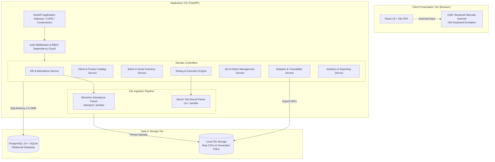
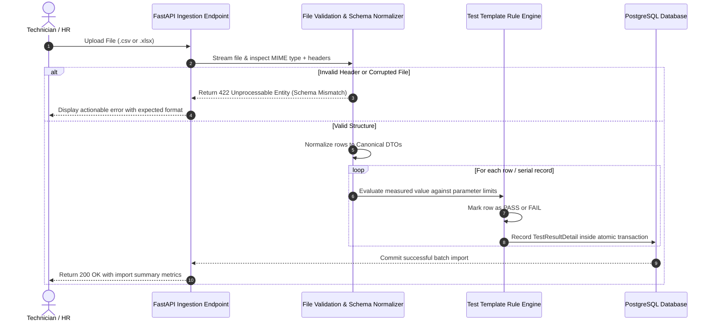

# System Architecture & Technical Design

**Project Name:** TestFlow — Integrated Electronics Testing, QA & Operations Management Platform  
**Document Version:** 1.0  
**Stack Variant:** Option B (FastAPI + React + PostgreSQL)  

---

## 1. Architectural Philosophy & Strategy

TestFlow is engineered with a **modular monolith** pattern. Given the operational requirements of an electronics testing facility and the delivery timeline of a solo student major project:
1. **Modularity without Distributed Overhead:** Rather than introducing microservices (which create networking, serialization, and deployment complexity), all core business domains (HR, Inventory, Testing, QA, Dispatch) are structured as decoupled modules within a single FastAPI application.
2. **Strict Ingestion Isolation:** Because testing machines and biometric clocks lack confirmed APIs, an **Ingestion Pipeline Service** acts as an anti-corruption layer, validating uploaded CSVs/Excel workbooks into strictly typed internal models.
3. **Audit Immutability:** The database schema enforces transactional foreign-key constraints to guarantee unbroken forward and backward traceability for every tested component.

---

## 2. System Architecture Diagram



---

## 3. Tier & Component Breakdown

### 3.1 Frontend Presentation Tier (React + Vite + TypeScript)
* **Single Page Application (SPA):** Built with Vite for rapid hot-module reloading and optimized production bundles.
* **UI Components:** **Tailwind CSS** paired with **Shadcn UI** accessible component primitives (Radix UI engine).
* **State & Server Synchronization:** **TanStack Query (React Query v5)** manages server state, caching, optimistic mutations, and background refetching.
* **Barcode Scanner Integration:** USB and Bluetooth handheld barcode/QR scanners act as standard HID (Human Interface Device) keyboard inputs. The UI implements global keyboard event listeners with debounce timers to seamlessly capture scanned serial numbers directly into active test forms without requiring focused input fields.

### 3.2 Application & Business Logic Tier (FastAPI)
* **FastAPI Framework:** Chosen for its asynchronous speed, automatic generation of OpenAPI/Swagger documentation (`/docs`), and rigorous runtime request validation using **Pydantic v2**.
* **Domain Service Architecture:**
  * `api/v1/`: HTTP routers declaring URL routes, request parameters, and response schemas.
  * `services/`: Encapsulated domain business logic (e.g., verifying test values against template min/max limits, calculating batch completion rates).
  * `core/security.py`: Password hashing with `passlib[bcrypt]` and JWT token issuing/verifying.
* **FastAPI Dependency Injection (RBAC):**
  Role verification is enforced cleanly at the route level via reusable FastAPI dependencies:
  ```python
  # Example architectural pattern
  @router.post("/qa/disposition", dependencies=[Depends(require_role(["QA_INSPECTOR", "SUPER_ADMIN"]))])
  async def submit_qa_disposition(...):
      ...
  ```

### 3.3 File Ingestion Pipeline (Anti-Corruption Layer)

To handle real-world variations in test machine logs and biometric attendance spreadsheets without brittle code:



### 3.4 Data & Persistence Tier
* **Primary Relational Store:** **PostgreSQL 15+**.
  * Complete ACID transaction guarantees are essential when updating batch unit counters, transitioning unit state, and allocating serial numbers to prevent double-allocation or race conditions.
  * Alembic manages version-controlled database schema migrations.
* **File Storage:** Local filesystem storage mounted under `/app/uploads` (or configurable S3-compatible bucket) storing:
  1. Raw uploaded test machine CSV files (for compliance audit retention).
  2. Generated Outbound Dispatch Challan PDF files.

---

## 4. Security & Authentication Architecture

1. **Token Lifecycle:**
   * User submits credentials to `/api/v1/auth/login`.
   * Server validates password against stored `bcrypt` hash.
   * Server responds with a signed JWT access token (`HS256`) containing `sub` (user ID), `role`, and `exp`.
   * Stored in an HTTP-only, secure, `SameSite=Lax` cookie to protect against Cross-Site Scripting (XSS).
2. **Authorization Enforcement:**
   * Every incoming request executes an `HTTPBearer` / cookie extraction dependency.
   * If token is invalid or expired, server returns `401 Unauthorized`.
   * If user role lacks required permissions, server returns `403 Forbidden`.

---

## 5. Technology Rationale for Option B (FastAPI vs. Alternatives)

| Evaluation Factor | FastAPI + SQLAlchemy (Selected Option B) | Node.js + Express (Option A) | Rationale |
| :--- | :--- | :--- | :--- |
| **Academic Defense & Presentation** | ⭐⭐⭐⭐⭐ **Built-in Swagger / OpenAPI docs** out of the box | ⭐⭐⭐ Requires manual swagger-ui setup or Swagger JSDoc | The auto-generated `/docs` UI provides an immediate interactive demonstration for professors and examiners. |
| **Excel & CSV Data Processing** | ⭐⭐⭐⭐⭐ Exceptional via **pandas** and **openpyxl** | ⭐⭐⭐ Good via `xlsx` / `csv-parser` | Python's data ecosystem makes tabular validation, missing-value imputation, and metric aggregation effortless. |
| **Type Safety & Data Validation** | ⭐⭐⭐⭐⭐ **Pydantic v2** runtime validation | ⭐⭐⭐⭐ TypeScript (compile time) + Zod | Pydantic ensures zero malformed data can reach database execution routines. |
| **Solo Developer Velocity** | ⭐⭐⭐⭐⭐ High productivity, low boilerplate | ⭐⭐⭐⭐ High productivity | Allows a single student developer to build all 7 modules within the academic semester. |

