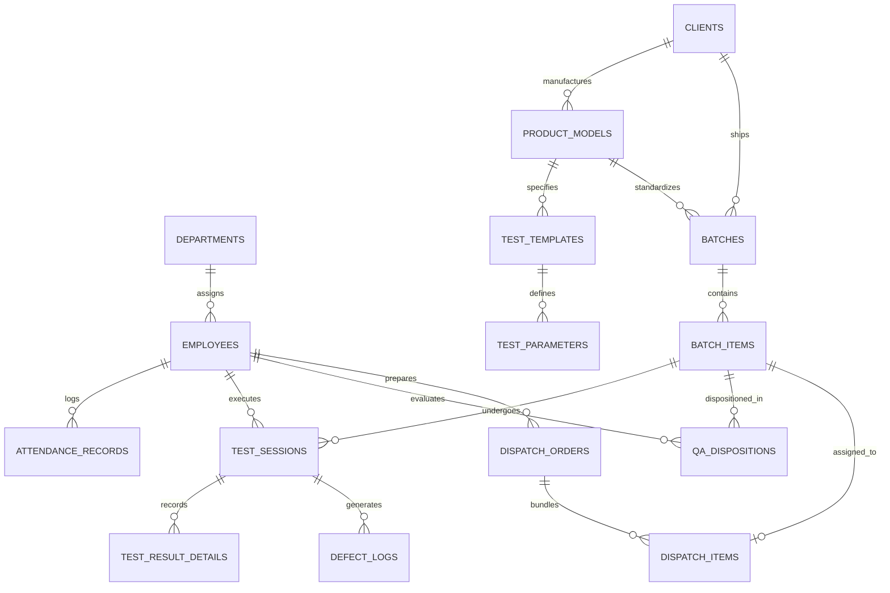
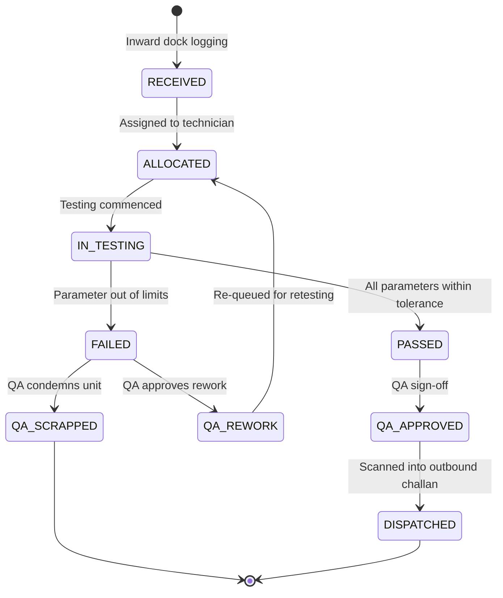

# Database Data Model & Entity Specifications

**Project Name:** TestFlow — Integrated Electronics Testing, QA & Operations Management Platform  
**Document Version:** 1.0  
**Target ORM:** SQLAlchemy 2.0 (PostgreSQL / SQLite)  

---

## 1. Entity-Relationship Overview

---

## 2. Table Schemas & Data Dictionaries

### 2.1 HR & Employee Domain

#### `departments`
| Column | Type | Constraints | Description |
| :--- | :--- | :--- | :--- |
| `id` | `INTEGER` | PK, Auto-increment | Unique identifier |
| `name` | `VARCHAR(100)` | NOT NULL, UNIQUE | Department name (e.g., Testing, QA, Warehouse, HR) |
| `code` | `VARCHAR(20)` | NOT NULL, UNIQUE | Short code (e.g., `DEP-TST`, `DEP-QA`) |
| `created_at` | `TIMESTAMP` | NOT NULL, DEFAULT `NOW()` | Record creation timestamp |

#### `employees`
| Column | Type | Constraints | Description |
| :--- | :--- | :--- | :--- |
| `id` | `INTEGER` | PK, Auto-increment | Primary key |
| `emp_code` | `VARCHAR(50)` | NOT NULL, UNIQUE | Unique employee badge code (e.g., `EMP-1001`) |
| `first_name` | `VARCHAR(100)` | NOT NULL | Given name |
| `last_name` | `VARCHAR(100)` | NOT NULL | Surname |
| `email` | `VARCHAR(255)` | NOT NULL, UNIQUE | Company email / login username |
| `password_hash`| `VARCHAR(255)` | NOT NULL | Bcrypt hashed password |
| `role` | `VARCHAR(50)` | NOT NULL | Enum: `SUPER_ADMIN`, `OPERATIONS_MGR`, `HR_OFFICER`, `STORE_KEEPER`, `TEST_SUPERVISOR`, `TEST_TECHNICIAN`, `QA_INSPECTOR` |
| `department_id`| `INTEGER` | FK -> `departments.id` | Department reference |
| `is_active` | `BOOLEAN` | NOT NULL, DEFAULT `TRUE` | Account active flag |
| `created_at` | `TIMESTAMP` | NOT NULL, DEFAULT `NOW()` | Timestamp |

#### `attendance_records`
| Column | Type | Constraints | Description |
| :--- | :--- | :--- | :--- |
| `id` | `INTEGER` | PK, Auto-increment | Primary key |
| `employee_id` | `INTEGER` | FK -> `employees.id`, NOT NULL | Target employee |
| `attendance_date`| `DATE` | NOT NULL | Calendar date |
| `punch_in` | `TIME` | NULLABLE | Shift start time |
| `punch_out` | `TIME` | NULLABLE | Shift end time |
| `status` | `VARCHAR(20)` | NOT NULL | Enum: `PRESENT`, `ABSENT`, `HALF_DAY`, `ON_LEAVE` |
| `source` | `VARCHAR(30)` | NOT NULL, DEFAULT `'MANUAL'` | Enum: `MANUAL`, `EXCEL_IMPORT`, `BIOMETRIC_DEVICE` |
| `created_at` | `TIMESTAMP` | NOT NULL, DEFAULT `NOW()` | Record created |

---

### 2.2 Client & Product Master Domain

#### `clients`
| Column | Type | Constraints | Description |
| :--- | :--- | :--- | :--- |
| `id` | `INTEGER` | PK, Auto-increment | Primary key |
| `name` | `VARCHAR(200)` | NOT NULL, UNIQUE | Client / OEM Company name |
| `code` | `VARCHAR(50)` | NOT NULL, UNIQUE | Short identifier (e.g., `TELCO-A`) |
| `contact_name`| `VARCHAR(150)` | NULLABLE | Primary representative |
| `email` | `VARCHAR(255)` | NULLABLE | Contact email |
| `phone` | `VARCHAR(50)` | NULLABLE | Phone number |
| `created_at` | `TIMESTAMP` | NOT NULL, DEFAULT `NOW()` | Record created |

#### `product_models`
| Column | Type | Constraints | Description |
| :--- | :--- | :--- | :--- |
| `id` | `INTEGER` | PK, Auto-increment | Primary key |
| `client_id` | `INTEGER` | FK -> `clients.id`, NOT NULL | Parent OEM Client |
| `category` | `VARCHAR(50)` | NOT NULL | Enum: `ROUTER`, `SET_TOP_BOX`, `REMOTE_CONTROL`, `IOT_GATEWAY`, `OTHER` |
| `model_number` | `VARCHAR(100)` | NOT NULL | Hardware model designation (e.g., `AX-3000PRO`) |
| `model_name` | `VARCHAR(200)` | NOT NULL | Commercial name |
| `specifications`| `JSONB / JSON` | NULLABLE | Flexible key-value specs (voltage, RF bands, firmware) |
| `created_at` | `TIMESTAMP` | NOT NULL, DEFAULT `NOW()` | Record created |

---

### 2.3 Testing Template Domain

#### `test_templates`
| Column | Type | Constraints | Description |
| :--- | :--- | :--- | :--- |
| `id` | `INTEGER` | PK, Auto-increment | Primary key |
| `product_model_id`| `INTEGER` | FK -> `product_models.id`, NOT NULL | Linked product model |
| `name` | `VARCHAR(200)` | NOT NULL | Template name (e.g., "Full RF & Functional Verification") |
| `version` | `INTEGER` | NOT NULL, DEFAULT `1` | Incrementing revision number |
| `is_active` | `BOOLEAN` | NOT NULL, DEFAULT `TRUE` | Current active template flag |
| `created_by` | `INTEGER` | FK -> `employees.id` | Authoring supervisor |
| `created_at` | `TIMESTAMP` | NOT NULL, DEFAULT `NOW()` | Creation date |

#### `test_parameters`
| Column | Type | Constraints | Description |
| :--- | :--- | :--- | :--- |
| `id` | `INTEGER` | PK, Auto-increment | Primary key |
| `template_id` | `INTEGER` | FK -> `test_templates.id`, NOT NULL | Parent template |
| `parameter_name`| `VARCHAR(150)`| NOT NULL | Name (e.g., `5GHz Tx Power`, `Power LED Check`) |
| `data_type` | `VARCHAR(30)` | NOT NULL | Enum: `NUMERIC_RANGE`, `BOOLEAN`, `TEXT` |
| `min_limit` | `FLOAT` | NULLABLE | Lower boundary for numeric tests |
| `max_limit` | `FLOAT` | NULLABLE | Upper boundary for numeric tests |
| `unit_of_measure`| `VARCHAR(30)`| NULLABLE | Unit string (e.g., `dBm`, `V`, `ms`) |
| `expected_text`| `VARCHAR(255)` | NULLABLE | Expected string comparison |
| `is_mandatory` | `BOOLEAN` | NOT NULL, DEFAULT `TRUE` | If failure automatically triggers session failure |
| `display_order`| `INTEGER` | NOT NULL, DEFAULT `0` | Order in execution UI |

---

### 2.4 Batch & Serial Inventory Domain

#### `batches`
| Column | Type | Constraints | Description |
| :--- | :--- | :--- | :--- |
| `id` | `INTEGER` | PK, Auto-increment | Primary key |
| `batch_number` | `VARCHAR(100)` | NOT NULL, UNIQUE | Unique internal batch tag (e.g., `BAT-20261101-01`) |
| `client_id` | `INTEGER` | FK -> `clients.id`, NOT NULL | Client reference |
| `product_model_id`| `INTEGER` | FK -> `product_models.id`, NOT NULL | Product reference |
| `inward_date` | `DATE` | NOT NULL | Date received at dock |
| `challan_number`| `VARCHAR(100)`| NULLABLE | Client delivery challan reference |
| `expected_qty` | `INTEGER` | NOT NULL | Invoice expected quantity |
| `received_qty` | `INTEGER` | NOT NULL | Actual counted quantity |
| `current_status`| `VARCHAR(30)` | NOT NULL | Enum: `RECEIVED`, `ALLOCATED`, `IN_TESTING`, `TESTED`, `QA_APPROVED`, `DISPATCHED` |
| `storage_location`| `VARCHAR(100)`| NULLABLE | Warehouse bay/rack |
| `created_at` | `TIMESTAMP` | NOT NULL, DEFAULT `NOW()` | Record created |

#### `batch_items` (Individual Serialized Units)
| Column | Type | Constraints | Description |
| :--- | :--- | :--- | :--- |
| `id` | `INTEGER` | PK, Auto-increment | Primary key |
| `batch_id` | `INTEGER` | FK -> `batches.id`, NOT NULL | Parent batch |
| `serial_number` | `VARCHAR(150)`| NOT NULL, UNIQUE | Physical serial number or generated tracking ID |
| `qr_code_hash` | `VARCHAR(255)` | NULLABLE | Quick scan identifier / hash |
| `current_status`| `VARCHAR(30)` | NOT NULL, DEFAULT `'RECEIVED'` | Enum: `RECEIVED`, `ALLOCATED`, `IN_TESTING`, `PASSED`, `FAILED`, `QA_APPROVED`, `QA_REWORK`, `QA_SCRAPPED`, `DISPATCHED` |
| `is_defective` | `BOOLEAN` | NOT NULL, DEFAULT `FALSE` | Active defect flag |
| `created_at` | `TIMESTAMP` | NOT NULL, DEFAULT `NOW()` | Record created |

---

### 2.5 Testing & QA Execution Domain

#### `test_sessions`
| Column | Type | Constraints | Description |
| :--- | :--- | :--- | :--- |
| `id` | `INTEGER` | PK, Auto-increment | Primary key |
| `batch_item_id` | `INTEGER` | FK -> `batch_items.id`, NOT NULL | Tested device unit |
| `template_id` | `INTEGER` | FK -> `test_templates.id`, NOT NULL | Test criteria version used |
| `technician_id` | `INTEGER` | FK -> `employees.id`, NOT NULL | Operator who performed test |
| `execution_type`| `VARCHAR(30)` | NOT NULL | Enum: `MANUAL`, `CSV_IMPORT` |
| `overall_result`| `VARCHAR(20)` | NOT NULL | Enum: `PASS`, `FAIL` |
| `execution_date`| `TIMESTAMP` | NOT NULL, DEFAULT `NOW()` | Execution timestamp |
| `remarks` | `TEXT` | NULLABLE | Operator observations |

#### `test_result_details`
| Column | Type | Constraints | Description |
| :--- | :--- | :--- | :--- |
| `id` | `INTEGER` | PK, Auto-increment | Primary key |
| `test_session_id`| `INTEGER` | FK -> `test_sessions.id`, NOT NULL | Parent test session |
| `parameter_id` | `INTEGER` | FK -> `test_parameters.id`, NOT NULL| Specific test parameter |
| `measured_value`| `VARCHAR(100)`| NOT NULL | Raw value entered or parsed from CSV |
| `result` | `VARCHAR(20)` | NOT NULL | Enum: `PASS`, `FAIL` |

#### `defect_logs`
| Column | Type | Constraints | Description |
| :--- | :--- | :--- | :--- |
| `id` | `INTEGER` | PK, Auto-increment | Primary key |
| `batch_item_id` | `INTEGER` | FK -> `batch_items.id`, NOT NULL | Defective unit |
| `test_session_id`| `INTEGER` | FK -> `test_sessions.id`, NULLABLE | Associated test session (if during test) |
| `defect_code` | `VARCHAR(50)` | NOT NULL | Standard code (e.g., `DEF-WIFI-01`) |
| `severity` | `VARCHAR(20)` | NOT NULL | Enum: `CRITICAL`, `MAJOR`, `MINOR` |
| `description` | `TEXT` | NOT NULL | Root cause description |
| `logged_by` | `INTEGER` | FK -> `employees.id`, NOT NULL | Technician or QA Inspector |
| `created_at` | `TIMESTAMP` | NOT NULL, DEFAULT `NOW()` | Log timestamp |

#### `qa_dispositions`
| Column | Type | Constraints | Description |
| :--- | :--- | :--- | :--- |
| `id` | `INTEGER` | PK, Auto-increment | Primary key |
| `batch_item_id` | `INTEGER` | FK -> `batch_items.id`, NOT NULL | Evaluated unit |
| `inspector_id` | `INTEGER` | FK -> `employees.id`, NOT NULL | QA officer signing off |
| `decision` | `VARCHAR(30)` | NOT NULL | Enum: `APPROVED`, `RETEST_REQUESTED`, `SCRAPPED` |
| `remarks` | `TEXT` | NULLABLE | Inspector notes / rework instructions |
| `disposition_at`| `TIMESTAMP` | NOT NULL, DEFAULT `NOW()` | Sign-off timestamp |

---

### 2.6 Outbound Dispatch Domain

#### `dispatch_orders`
| Column | Type | Constraints | Description |
| :--- | :--- | :--- | :--- |
| `id` | `INTEGER` | PK, Auto-increment | Primary key |
| `challan_number`| `VARCHAR(100)`| NOT NULL, UNIQUE | Outbound delivery challan (e.g., `DISP-202611-004`) |
| `client_id` | `INTEGER` | FK -> `clients.id`, NOT NULL | Recipient client |
| `dispatch_date` | `DATE` | NOT NULL | Shipping date |
| `carrier_name` | `VARCHAR(150)`| NULLABLE | Logistics provider (e.g., Bluedart, FedEx) |
| `vehicle_number`| `VARCHAR(50)` | NULLABLE | Transport vehicle plate |
| `total_units` | `INTEGER` | NOT NULL, DEFAULT `0` | Unit count |
| `created_by` | `INTEGER` | FK -> `employees.id`, NOT NULL | Store keeper / Operations manager |
| `created_at` | `TIMESTAMP` | NOT NULL, DEFAULT `NOW()` | Creation date |

#### `dispatch_items`
| Column | Type | Constraints | Description |
| :--- | :--- | :--- | :--- |
| `id` | `INTEGER` | PK, Auto-increment | Primary key |
| `dispatch_order_id`| `INTEGER`| FK -> `dispatch_orders.id`, NOT NULL | Outbound order |
| `batch_item_id` | `INTEGER` | FK -> `batch_items.id`, NOT NULL, UNIQUE | Serial unit packed (One dispatch per unit) |

---

## 3. State Machine Diagrams

### 3.1 Batch Item (Unit Serial) State Flow

---

## 4. Universal Traceability Query Structure

To deliver the end-to-end traceability timeline for any router or set-top box serial number, the following join hierarchy is executed:

$$\begin{aligned}
\text{batch\_items} &\bowtie \text{batches} \bowtie \text{clients} \\
&\bowtie \text{product\_models} \\
&\bowtie \text{test\_sessions} \bowtie \text{test\_result\_details} \bowtie \text{test\_parameters} \\
&\bowtie \text{employees (technician)} \\
&\bowtie \text{qa\_dispositions} \bowtie \text{employees (QA inspector)} \\
&\bowtie \text{dispatch\_items} \bowtie \text{dispatch\_orders}
\end{aligned}$$

This query reconstructs the complete chronological birth-to-dispatch story in $< 50$ ms.

