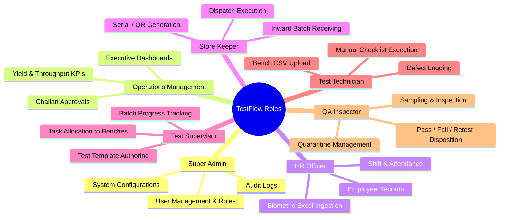

# System Requirements Specification (SRS)

**Project Name:** TestFlow — Integrated Electronics Testing, QA & Operations Management Platform  
**Document Version:** 1.0  
**Target Architecture:** Option B (FastAPI + React + PostgreSQL)  
**Academic Context:** Internship Major Project  

---

## 1. Introduction & Business Problem

In high-throughput electronics testing facilities handling consumer telecommunications and peripherals (Wi-Fi routers, remote controls, set-top boxes, and IoT gateways), testing operations must coordinate high volumes of physical devices under strict turnaround times.

Current workflows frequently suffer from:
* **Fragmented Data Islands:** Technicians log manual steps on printed paper traveler sheets, attendance is exported from standalone biometric devices into disparate Excel workbooks, and automated test benches dump raw log files into unindexed local directories.
* **Loss of End-to-End Traceability:** When a customer reports a field defect or when a batch has a high failure rate, tracing a unit's history back to its incoming vendor batch, the testing technician, the specific test parameters recorded, and the approving QA inspector requires hours of manual cross-referencing.
* **Operational Blind Spots:** Management and floor supervisors lack a single pane of glass to view real-time batch testing progress, operator yield, bench bottlenecks, and shift attendance.

**TestFlow** replaces these disjointed workflows with a unified, role-based platform designed for factory floor usability.

---

## 2. User Personas & Roles

---

## 3. Functional Requirements by Module

### Module 1: Employee & HR Management
* **FR-1.1 Profile Management:** Store employee details (`EmployeeCode`, `FirstName`, `LastName`, `Email`, `Phone`, `Department`, `Designation`, `Role`, `DateOfJoining`, `Status`).
* **FR-1.2 Shift & Attendance Recording:**
  * Support manual daily check-in and check-out via web portal.
  * Record attendance status (`Present`, `Absent`, `Half-Day`, `Leave`).
* **FR-1.3 Biometric Excel Import:**
  * Allow HR officers to bulk-upload monthly biometric logs in `.xlsx` format.
  * Parser must support flexible column mappings (`EmpId`, `Date`, `InTime`, `OutTime`).
* **FR-1.4 Attendance Analytics & Availability:**
  * Calculate monthly attendance percentages per employee.
  * Display a real-time "Floor Availability" widget for test supervisors to know who is present on shift before allocating batches.

### Module 2: Client & Product Management
* **FR-2.1 Client Master:** Manage OEM clients (telecom operators, hardware vendors) with contact details, contracts, and address information.
* **FR-2.2 Product Catalog:**
  * Support product categories: `Wi-Fi Router`, `Set-Top Box (STB)`, `Remote Control`, `IoT Gateway`.
  * Store model numbers, hardware revisions, and specification schemas (e.g., input voltage, frequency bands, firmware versions).
* **FR-2.3 Client Test Requirements:**
  * Allow defining client-specific testing guidelines and tolerances linked directly to product models.

### Module 3: Batch & Inventory Management
* **FR-3.1 Inward Batch Receiving:**
  * Log incoming shipments with `BatchNumber`, `ClientId`, `ProductModelId`, `InwardDate`, `ChallanNumber`, `ExpectedQty`, `ReceivedQty`, and `StorageBay`.
* **FR-3.2 Serialization & Unit Identification:**
  * Support bulk import of pre-existing vendor serial numbers via CSV/text list.
  * Support auto-generation of unique internal serial numbers (e.g., `TF-RTR-2601-0001`).
  * Generate printable QR code / barcode representations for each unit.
* **FR-3.3 Batch Lifecycle State Machine:**
  * Enforce strict transitions:
    $$\text{RECEIVED} \longrightarrow \text{ALLOCATED} \longrightarrow \text{IN\_TESTING} \longrightarrow \text{TESTED} \longrightarrow \text{QA\_APPROVED} \longrightarrow \text{DISPATCHED}$$
* **FR-3.4 Batch Movement & Allocation:**
  * Track physical movement between factory zones (Store -> Staging -> Test Bench -> QA Quarantine -> Dispatch Packing).

### Module 4: Testing Management
* **FR-4.1 Configurable Test Templates:**
  * Build dynamic checklists per product model.
  * Parameter data types supported:
    1. `BOOLEAN`: Pass/Fail toggle (e.g., "Power LED illuminated").
    2. `NUMERIC_RANGE`: Measured value validated against `[Min, Max]` limits (e.g., "5GHz RF Power: 18.0 to 22.0 dBm").
    3. `TEXT`: Firmware string or serial verification.
* **FR-4.2 Task Allocation:**
  * Supervisors allocate batch partitions or specific serial units to active technicians.
* **FR-4.3 Manual Test Execution UI:**
  * Streamlined, single-screen interface for technicians to verify units with minimal keystrokes.
  * Compatible with standard USB handheld barcode scanners (scanned serial auto-loads the test record).
* **FR-4.4 Automated Bench Result Import:**
  * Accept standard `.csv` or `.xlsx` files produced by automated test benches (e.g., automated RF/Wi-Fi script dumps).
  * System parses measurements, compares them against template thresholds, and tags results automatically.

### Module 5: Quality Assurance & Defect Management
* **FR-5.1 Defect Logging:**
  * When a test parameter fails, allow logging of standardized defect codes (e.g., `DEF-RF-01`, `DEF-PORT-04`), defect severity (`Minor`, `Major`, `Critical`), and descriptive notes.
* **FR-5.2 QA Disposition Engine:**
  * QA inspectors evaluate completed units/batches with three disposition outcomes:
    1. `APPROVED`: Eligible for packaging and dispatch.
    2. `RETEST_REQUESTED`: Defect tagged; unit routed back to technician queue.
    3. `SCRAPPED / REJECTED`: Unit permanently quarantined for vendor return or salvage.
* **FR-5.3 Quality History:**
  * Maintain an immutable log of all inspections, retests, and sign-offs.

### Module 6: Dispatch & Traceability
* **FR-6.1 Dispatch Challan Creation:**
  * Create outbound shipping challans against client orders.
  * Enforce that **only units marked `QA_APPROVED`** can be assigned to a dispatch challan.
* **FR-6.2 Universal Serial Number Traceability (Audit Timeline):**
  * Provide a dedicated search interface where entering any serial number instantly renders its complete chronological audit trail:
    * Inward batch, date, and challan.
    * Assigned technician and workstation.
    * Exact test execution timestamp, parameters measured, and result values.
    * Defect notes (if any) and retest records.
    * Approving QA inspector and timestamp.
    * Outbound dispatch challan, carrier, and destination.
* **FR-6.3 Gate Pass Generation:** Export printable PDF dispatch notes with packing lists.

### Module 7: Dashboards & Reporting
* **FR-7.1 Role-Tailored Dashboards:**
  * **Management:** Yield rate ($\frac{\text{Passed}}{\text{Total Tested}} \times 100$), daily throughput volume, defect Pareto chart.
  * **Test Supervisor:** Live batch progress bars, active technician test counts, bottleneck alerts.
  * **HR Officer:** Today's present/absent counts, shift coverage, missing punch reports.
* **FR-7.2 Operational Export:** Export summary reports to `.xlsx` and `.pdf`.

---

## 4. Non-Functional Requirements (NFR)

* **NFR-1 Security & Access Control:**
  * Passwords hashed using `bcrypt` (work factor 12).
  * Stateless session authorization via JWT tokens stored in HTTP-only, secure cookies.
  * Strict RBAC endpoint guards on all FastAPI routes.
* **NFR-2 Data Integrity & Traceability:**
  * Foreign key constraints enforced at database level with cascade protections against accidental data deletion.
  * Audit fields (`created_at`, `updated_at`, `created_by`) on all operational tables.
* **NFR-3 Performance:**
  * Bulk ingestion of 1,000 serial numbers or bench test records must parse and commit within $< 3$ seconds.
  * Standard dashboard queries must execute in $< 300$ ms.
* **NFR-4 Usability on Factory Floor:**
  * Clean UI responsive on standard desktop monitors and touchscreen tablets.
  * Full keyboard/barcode-scanner navigation support for repetitive testing workflows.

---

## 5. Scope Boundary: v1 MVP vs. Future Enhancements

| Feature Category | In-Scope: Version 1 MVP (Achievable for Solo Student) | Out-of-Scope: Future Roadmap (v2+) |
| :--- | :--- | :--- |
| **Test Equipment Integration** | File-based ingestion (standard CSV/Excel log uploads) | Direct hardware sockets, serial COM ports, MODBUS |
| **Paper Record Handling** | Clean manual entry web forms & Excel ingestion | OCR scanning of handwritten paper traveler sheets |
| **Scanning Hardware** | Standard USB/Bluetooth keyboard-emulation barcode scanners | Custom Android mobile APK with computer vision scanning |
| **Statistical Process Control**| Basic Defect Pareto and First-Pass Yield percentages | Advanced Six Sigma / Cpk calculation engines |
| **HR Biometrics** | Monthly Excel export parser & manual attendance | Direct TCP/IP network listener for biometric timeclocks |
| **Notifications** | In-app notification badges and alert banners | Twilio SMS / WhatsApp API / Push notifications |

---

## 6. Open Operational Questions for Company Alignment

> [!WARNING] Unresolved Workflow Details
> The following items must be verified during project check-ins with your supervisor. The software architecture is designed to accommodate either outcome without structural rework.

1. **[Q1] Serial Number Sticker Ownership:**
   * *Status:* Unconfirmed whether client shipments arrive pre-labeled with barcodes or if internal serialized QR labels must be printed.
   * *System Fallback:* System supports both manual/CSV vendor serial importing and auto-generation of internal serials.
2. **[Q2] Automated Test Bench Log Schema:**
   * *Status:* Exact column headers produced by bench computers (e.g., RF tester, Ping tester) are unconfirmed.
   * *System Fallback:* Implemented canonical parser with configurable column header mappings.
3. **[Q3] Biometric Attendance Export Structure:**
   * *Status:* The exact biometric software export format (e.g., eSSL, Matrix, ZKTeco) is unconfirmed.
   * *System Fallback:* Flexible Excel parser supporting common column aliases.
4. **[Q4] Sampling Policies:**
   * *Status:* Confirmation needed whether low-cost remotes use AQL sampling while routers use 100% testing.
   * *System Fallback:* The QA module supports both individual serial disposition and batch-level bulk disposition.

