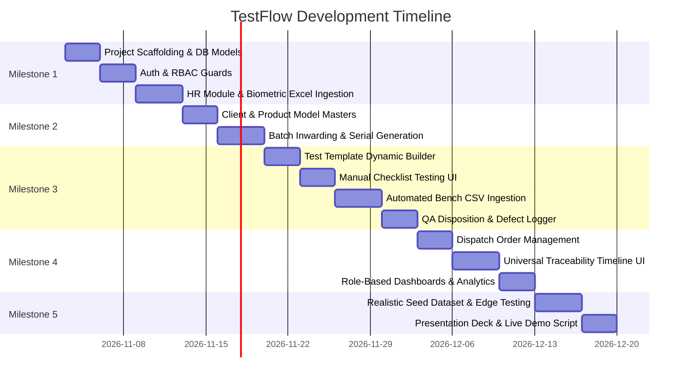

# Development Roadmap & Project Milestones

**Project Name:** TestFlow — Integrated Electronics Testing, QA & Operations Management Platform  
**Document Version:** 1.0  
**Target Completion:** Academic Internship Major Project Delivery  

---

## 1. Development Phasing Overview

The roadmap is structured into 5 sequential milestones designed for an achievable, high-impact solo student workflow. Each milestone produces a testable, demonstrable slice of functionality.

---

## 2. Detailed Milestone Breakdown

### Milestone 1: Project Foundation, Auth & HR Module
* **Deliverables:**
  * Initialized Git repo, FastAPI backend scaffold with Pydantic v2 and SQLAlchemy 2.0.
  * PostgreSQL connection with Alembic migration baseline.
  * User authentication with JWT (HTTP-only cookies) and 7-role RBAC dependency injection.
  * Employee profiles CRUD and daily manual punch in/out.
  * **Biometric Excel Parser:** Ingestion service that uploads `.xlsx` files, matches `EmpCode`, and logs attendance records.
* **Acceptance Criteria:**
  * Ability to log in as `HR_OFFICER` and upload a sample 20-row attendance spreadsheet.
  * Shift coverage widget displays who is available on the floor today.

### Milestone 2: Product Catalog & Batch/Serial Inwarding
* **Deliverables:**
  * Client and Product Model CRUD (categories: Routers, STBs, Remotes).
  * Inward Batch receiving interface (recording vendor challan, expected/received quantity, and storage bay).
  * Serialization Service:
    * Bulk import of existing vendor serial numbers (copy/paste or CSV).
    * Auto-generator for internal serials (`TF-RTR-YYMM-####`).
    * On-screen printable QR code labels.
* **Acceptance Criteria:**
  * Inward batch created for 100 Wi-Fi Routers with 100 serialized child records generated in `RECEIVED` state.

### Milestone 3: Test Engine, Bench CSV Ingestion & QA Dispositions
* **Deliverables:**
  * Dynamic Test Template Builder supporting numeric ranges (min/max), boolean checks, and text comparisons.
  * Manual Testing screen designed for fast barcode-scanner input and single-click pass/fail recording.
  * **Bench Test CSV Importer:** Ingestion parser that evaluates measured parameters against template bounds and flags out-of-spec readings.
  * Defect Logging module with standardized defect codes and severity categorization.
  * QA Inspector Portal: Sampling interface, pass/fail/retest dispositioning, and quarantine tagging.
* **Acceptance Criteria:**
  * Technicians can test a unit manually or upload a 50-row CSV from an automated bench; out-of-spec units are tagged `FAILED` and blocked from QA approval.

### Milestone 4: Dispatch, Universal Traceability & Dashboards
* **Deliverables:**
  * Dispatch Challan builder: Enforces that only units in `QA_APPROVED` state can be packed and dispatched.
  * **Universal Serial Traceability Search:** Entering any serial number displays the complete chronological birth-to-dispatch timeline (inward lot, technician, measured test values, QA sign-off, dispatch carrier).
  * Executive & Operational Dashboards: Live yield percentage, throughput counters, and defect Pareto chart.
* **Acceptance Criteria:**
  * Entering serial `SN-AX58U-00101` renders its complete lifecycle audit trail in $< 100$ ms.

### Milestone 5: Verification, Seed Data & Academic Defense Preparation
* **Deliverables:**
  * Robust database seed script creating realistic test scenarios:
    * 3 OEM clients (e.g., Telco One, Broadband X, SmartHome Corp).
    * 4 Product models (Wi-Fi 6 Router, Android 4K STB, Bluetooth Remote, IoT Zigbee Hub).
    * 5 Inward batches (total 300+ serialized units across various states: Received, In-Testing, Failed, QA Approved, Dispatched).
  * Comprehensive test suite (`pytest`) covering schema validation and state machine transitions.
  * Slide deck outline and 10-minute live demonstration script highlighting business ROI and engineering integrity.
* **Acceptance Criteria:**
  * Clean, polished demonstration ready to run offline or on local staging without hiccups.

---

## 3. Risk Assessment & Mitigation Strategies

| Identified Risk | Probability | Impact | Mitigation Strategy |
| :--- | :---: | :---: | :--- |
| **Biometric Excel file format variations** | High | Medium | Implement column alias mapping in `services/attendance_importer.py` to recognize varying column names (`EmpId`, `BadgeID`, `Code`). |
| **Incomplete equipment log specifications** | High | Medium | Canonical CSV format defined in documentation; parser provides sample template download for bench operators. |
| **Scope creep during solo semester** | Medium | High | Strict MVP boundary maintained: no hardware COM port listeners or mobile native apps in v1. |
| **Data inconsistencies during bulk serial inserts** | Low | High | Use bulk database transactions (`db.bulk_insert_mappings`) with unique constraints on serial numbers to prevent duplicates. |

---

## 4. Academic Presentation & Defense Script Highlights

During the major project presentation, emphasize:
1. **Engineering Problem Solving:** Replacing vulnerable paper/Excel fragmentation with an enterprise ACID-compliant relational model.
2. **Factory-Floor Ergonomics:** Demonstration of barcode scanner input and instant serial lifecycle search.
3. **Traceability Guarantee:** Showing how a simulated field-defective router can be traced back to the exact test bench parameters and operator in seconds.
4. **Architectural Maturity:** Auto-generated interactive Swagger API documentation, role-based security guards, and modular domain architecture.

